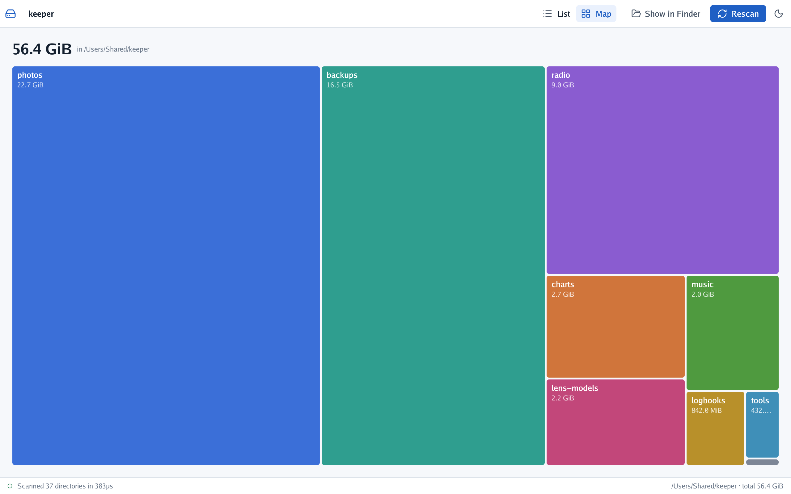
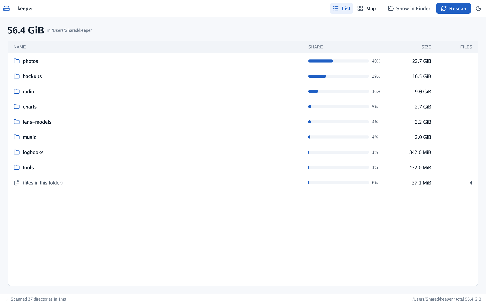
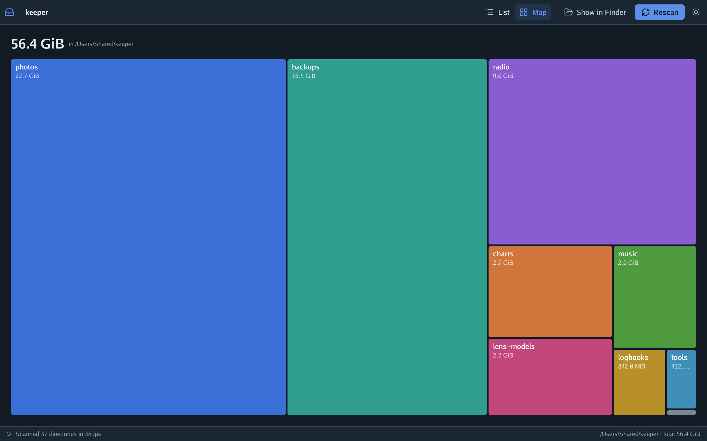
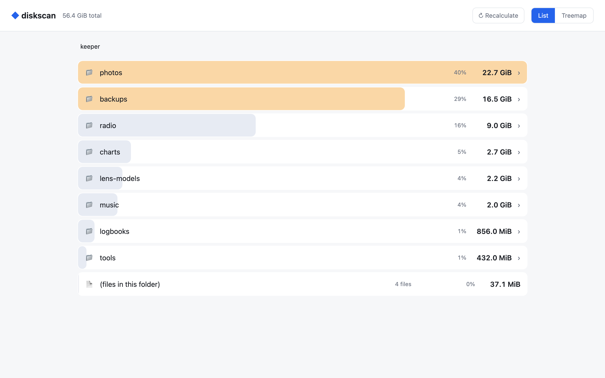

# diskscan

## AI disclosure

I write most of my code by hand, so I want to be clear about this project: **it was written by an
AI assistant (Claude, by Anthropic) under my direction.** I decided what to build and how it should
behave; the code, the tests and the documentation were written by the AI. Every commit made this
way carries a `Co-Authored-By: Claude` line.

**Status: pending thorough review.** The code compiles and its tests pass, but I have not yet
reviewed it line by line. Treat it as a working draft, not as code I vouch for.

## What it is

A disk usage explorer for macOS: it walks a folder once, then lets you drill down to see what is
taking the space. It comes in two flavours over the same scanner:

- **`diskscan-ui`** — a native window drawn with [go-ui](https://github.com/akrck02/go-ui) on
  [go-renderer](https://github.com/akrck02/go-renderer), with a list and a map of rectangles.
- **`diskscan`** — a small local web server with the same views in your browser.



```bash
go build -o diskscan-ui ./cmd/diskscan-ui && ./diskscan-ui ~        # the window
go build -o diskscan . && ./diskscan -open ~                         # the web version
```

## Install

Download the zip for the version you want from
[Releases](https://github.com/akrck02/diskscan/releases): universal binaries (Apple Silicon and
Intel) for macOS 13 or later.

```bash
unzip diskscan-ui-v0.1.0-macos-universal.zip
xattr -d com.apple.quarantine diskscan-ui    # see below
./diskscan-ui ~
```

The binaries are not signed with an Apple Developer ID, so macOS blocks them the first time with
*"cannot be verified"*. Removing the quarantine flag as above (or right-click → **Open** in Finder)
lets them run. If you would rather not, build them yourself (see [Building](#building)).

**Linux:** the web version comes for amd64 and arm64, as static binaries with nothing else to
install. The window is not in the release yet: it should build on Linux (go-ui falls back to OpenGL
there) but needs cgo and the OpenGL/X11 development packages, so build it there yourself.

```bash
tar -xzf diskscan-v0.1.0-linux-amd64.tar.gz
./diskscan -open ~
```

## The window

Folders are listed biggest first, each with a bar for its share of the folder you are in. Click a
folder to go into it; the crumbs at the top take you back up. The files that sit directly in a
folder are added up into one *(files in this folder)* line.



**Map** shows the same folder as a [squarified treemap](https://www.win.tue.nl/~vanwijk/stm.pdf):
the area of each rectangle is its size, and the layout keeps them close to squares so they are
easy to compare. Folders smaller than 0.2 % of the one on show (and anything past the 80th) share a
grey *N smaller items* rectangle; hover any rectangle for its full name and size.



**Show in Finder** opens the folder on show, **Rescan** walks the disk again (in the background,
with a running count in the status bar), and the sun/moon button switches theme.

| Flag | |
|---|---|
| `-map` | start on the map instead of the list |
| `-dark` | start with the dark theme |
| `-width`, `-height` | window size |
| `-capture shot.png` | scan, draw a single frame to a PNG and exit (how the pictures here were made) |
| `-backend metal\|opengl` | what draws the window (Metal by default on macOS) |

## The web version

The original version, kept alongside: it serves the views on `127.0.0.1` only, and its *reveal*
endpoint only accepts paths inside the scanned tree.



| Flag | |
|---|---|
| `-port N` | port to serve on (default `8080`) |
| `-open` | open the browser when the scan is done |

## How it works

`scan/` walks the tree once with a bounded pool of goroutines and keeps **only folders** in
memory (each with the total of the files directly in it), so memory grows with the number of
folders, not files. Symbolic links are not followed or counted, and folders it cannot read are
skipped. Sizes are each file's apparent size (what `ls -l` says), not the blocks it takes on disk.

```
scan/                 the scanner, shared by both front-ends
cmd/diskscan-ui/      the window: main.go (list, toolbar, scanning), treemap.go (the map)
main.go, index.html   the web version
```

## Building

The window needs cgo and Metal or OpenGL 4.1; the web version is plain Go.

Until go-renderer publishes its `draw2d` package on `main`, `go.mod` takes go-ui and go-renderer
from their GitHub branches, and a `replace` points go-renderer at the commit go-ui needs (go-ui's
own `replace` points at a local folder, which does not apply here). To move to newer commits:

```bash
go get github.com/akrck02/go-ui@<branch>
go mod edit -replace github.com/akrck02/go-renderer=github.com/akrck02/go-renderer@<commit>
```

To make the release archives in `dist/` (universal binaries for macOS 13+, the web version for
Linux amd64 and arm64, and checksums):

```bash
scripts/release.sh v0.1.0
```

```bash
go vet ./...
go test ./...      # no window needed: the scanner and the map's layout are tested on their own
```
