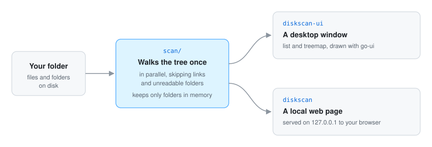

# 🔍 How it works

  

Both programs are thin front-ends over one package, [`scan/`](../scan/scan.go).

## The scan

`scan.Tree` walks the folder once, reading folders in parallel. A bounded pool of goroutines (four
per CPU, at least eight) keeps it from opening thousands of folders at once. When the pool is full,
the current goroutine reads the next folder itself instead of waiting.

It keeps **only folders** in memory. Each folder records the total size and count of the files
directly inside it, plus its subfolders. So memory grows with the number of folders, not files: a
folder of a million photos costs the same as an empty one. When the walk ends, one pass adds the
sizes up from the bottom, so every folder knows its full size.

The programs then read that tree: `Entries` lists a folder's contents biggest first, `Lookup`
finds a folder by path, and `Crumbs` builds the path at the top of the window.

## What the sizes mean

> [!NOTE]
> Sizes are the **space files take on disk**, as `du` counts it, not the file sizes `ls -l`
> shows. The two are usually close, but they differ for:
> - **sparse files**, such as virtual machine disks and some databases, which look far larger
>   than they are: a 24 GB Docker disk can take only 8 GB, and diskscan shows the 8;
> - **hard links**: a file with several names is counted once, in the first folder the scan
>   reaches it from;
> - **compressed or deduplicated file systems**, and APFS clones, where files share blocks. Each
>   clone is still counted in full.

The scan also leaves some things out on purpose:

- **Symbolic links are skipped**, both to folders and to files. Following them could count the same
  data twice, or loop forever on a link that points back up.
- **Folders you cannot read are skipped** silently. They still appear, but empty. Run it with more
  permissions if you need them counted.
- **The scan is a snapshot.** Deleting files does not change the numbers until you rescan.

## The treemap

The map uses the **squarified** layout by
[Bruls, Huizing and van Wijk](https://www.win.tue.nl/~vanwijk/stm.pdf). Rectangles that are close
to squares are much easier to compare than the thin slivers a simple layout produces.

It works in strips. Given the space left, it takes the biggest items one at a time and adds them to
a strip along the shorter side. It stops when adding the next item would make the strip's most
stretched rectangle worse. That strip is laid down, and the same happens with the rest of the space.

go-ui has no absolute positioning, and the map does not need any: each strip is a box whose children
share its length by weight, next to a box holding what is left. The geometry (`cutStrip`) is kept
apart from the drawing, so the tests check the layout without opening a window: that every area is
in proportion to its size, that the tiles cover the space exactly, and that equal items come out
nearly square.
