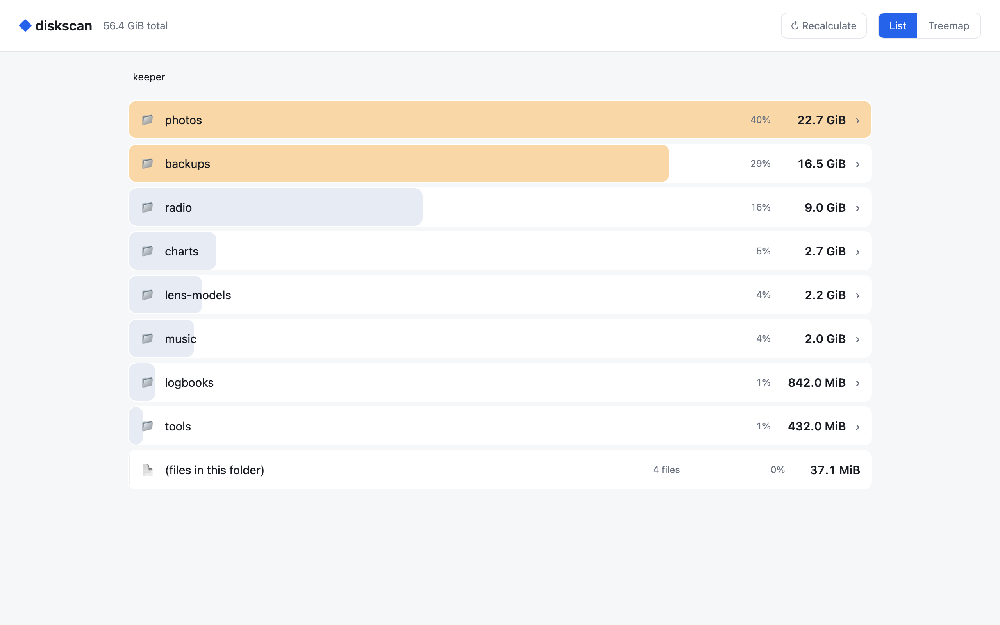

# 🖱️ Using diskscan

## The window

```bash
diskscan-ui [flags] [folder]      # folder defaults to the current one
```

The window opens straight away and scans in the background, with a counter in the status bar. A
home folder with a few hundred thousand folders takes around 15 seconds. Once the scan is done,
everything is instant: it does not touch the disk again until you rescan.

<picture>
  <source media="(prefers-color-scheme: dark)" srcset="images/list-dark.png">
  
</picture>

| In the window | |
|---|---|
| Click a folder | Go into it. |
| The path at the top | Go back up to any folder on the way. The arrow goes up one level. |
| **List** / **Map** | Switch between the sorted list and the treemap. |
| **Show in Finder** | Open the current folder in your file manager. |
| **Rescan** | Scan everything again, for example after deleting something. |
| Sun / moon button | Light or dark theme. |

**The list** shows the folders biggest first, each with a bar for its share of the current folder.
Files that sit directly in the folder are added up into one *(files in this folder)* line, with
their count.

**The treemap** shows the same folder as rectangles whose area is their size. Hover a rectangle to
see its full name and size. Items smaller than 0.2 % of the folder, and anything past the 80
biggest, are lumped into one grey *N smaller items* rectangle so the map stays readable.

<picture>
  <source media="(prefers-color-scheme: dark)" srcset="images/map-dark.png">
  
</picture>

| Flag | |
|---|---|
| `-map` | Start on the treemap instead of the list. |
| `-dark` | Start in dark mode. |
| `-width N`, `-height N` | Window size in points (default 1100 × 720). |
| `-capture file.png` | Scan, save one frame as a PNG and exit. Used for screenshots and in CI. |
| `-backend metal\|opengl` | What draws the window. Metal is the default on macOS, OpenGL elsewhere. |

## The web version

```bash
diskscan [-port 8080] [-open] [folder]
```

It scans the folder first (with a progress line in the terminal), then serves the views at
`http://127.0.0.1:8080`. Stop it with Ctrl-C.

<picture>
  <source media="(prefers-color-scheme: dark)" srcset="images/web-dark.png">
  
</picture>

| Flag | |
|---|---|
| `-port N` | Port to serve on (default `8080`). |
| `-open` | Open your browser when the scan is done. |

It listens only on `127.0.0.1`, so nothing on your network can reach it. Its *reveal in Finder*
endpoint only accepts folders inside the one you scanned.
